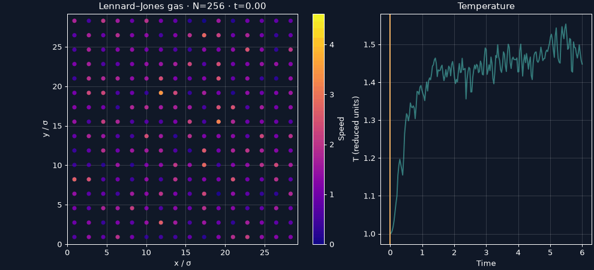
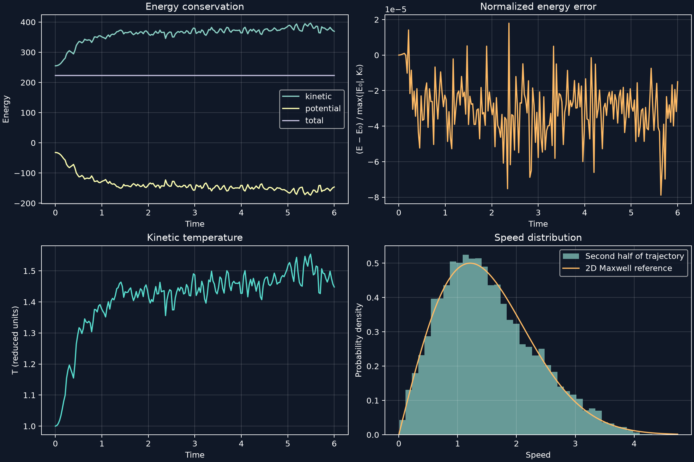
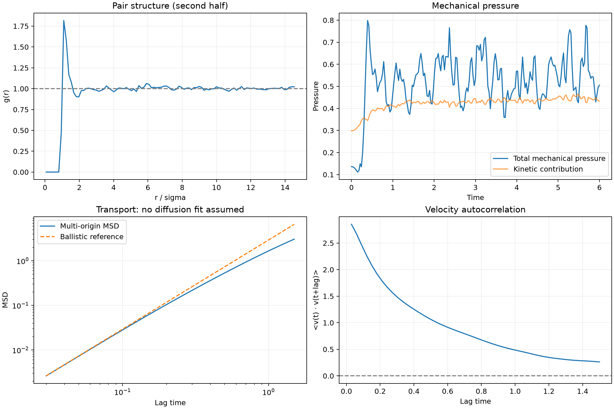
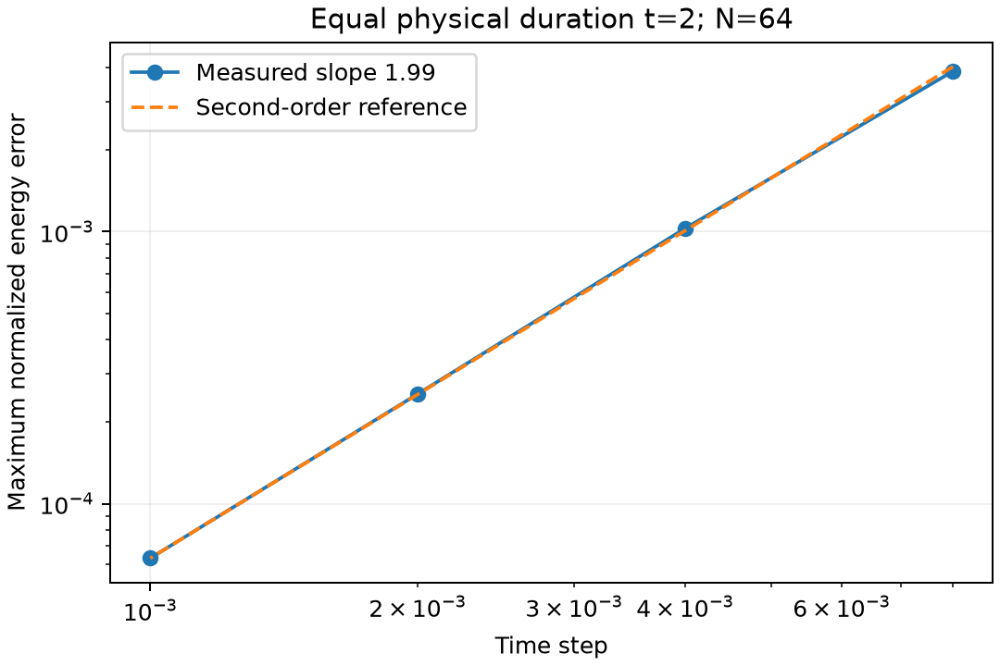
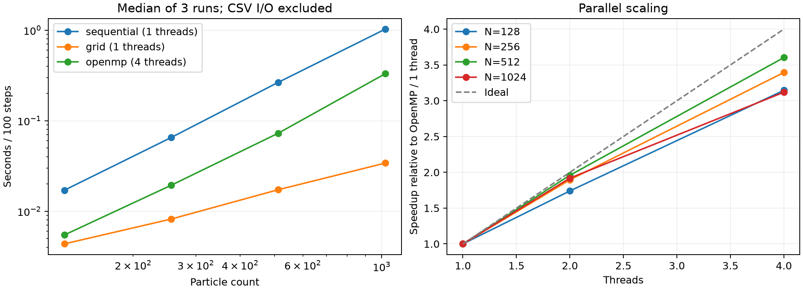

# Results and physical interpretation

[Українська](FIGURES.uk.md) · [Physics](PHYSICS.en.md) · [Home](../README.md)

The results cover energy and temperature evolution, spatial and temporal correlations, integration convergence and algorithmic performance. Numerical values refer to the reported trajectory and timing measurements.

## 1. Experimental protocol

The main experiment uses N=256, density 0.3, initial T=1, seed 42, h=0.002, 3000 steps and a saved frame every 15 steps. Thus L≈29.21187, duration is 6 reduced time units, and 201 frames are stored. Forces use the serial cell grid and the force-shifted cutoff rc=2.5. There is no thermostat. Structural and transport analysis uses saved times 3≤t≤6; this is an explicit heuristic analysis window, not a proven equilibration time.

The convergence study is a separate 64-particle experiment. Structural and transport figures use uniformly spaced frames from the main run.

## 2. Particle animation

The left panel displays wrapped x and y positions. Color encodes speed $`\sqrt{v_x^2+v_y^2}`$, with one fixed color scale for the entire animation. Brighter points represent faster particles. Point size is illustrative and does not define a hard collision diameter. The right panel shows the temperature history; a moving line identifies the current frame.

A particle disappearing at one edge and appearing at the opposite edge is the intended periodic boundary condition. Continuous forces produce deflections without an explicit hard-sphere collision rule. Initial grid order relaxes; the temperature rises as potential energy falls. Playback is 20 frames/s; simulation samples are 0.03 time units apart, so playback time is not physical time.

## 3. Energy, temperature and speed distribution

### 3.1 Energy conservation, upper left

The horizontal axis is simulation time; the vertical axis is total reduced energy, not energy per particle. K is positive; U can be negative because its reference is the cutoff; E=K+U is the conserved target.

K rises while U falls during rearrangement. Their cancellation leaves E nearly horizontal. This is conversion between interaction and motion energy inside an isolated system, not energy injection. The apparent flatness of E is not enough to quantify accuracy because the axis also contains much larger variations in K and U.

### 3.2 Normalized energy error, upper right

The displayed signed quantity is

$$\delta_E(t)=\frac{E(t)-E(0)}{\max(|E(0)|,K(0))}.$$

The denominator avoids an ill-conditioned relative error when E(0)≈0. The experiment has maximum |δE|≈7.8831×10⁻⁵, or **0.0078831%**, over the saved frames. This is an integration diagnostic, not an error bar on temperature. It is not exactly “relative error divided by E₀” because the chosen denominator can be K₀. Saved-frame sampling may miss intermediate extrema; the convergence study below records every step.

The small amplitude of energy fluctuations is consistent with the chosen integration step. Independent energy and pressure recomputation and agreement among the three algorithms complement this numerical check.

### 3.3 Kinetic temperature, lower left

The plotted $`T=K/(N-1)`$ removes the two constrained center-of-mass degrees of freedom. Initial T=1 is exactly set by velocity rescaling. Mean T in the second half is **1.47049**. A higher later temperature is expected when attractive relaxation lowers potential energy.

Fluctuations are physical finite-system fluctuations plus numerical error. A flat-looking segment is useful evidence but does not alone prove stationarity. No uncertainty interval is claimed: neighboring frames are correlated, and dividing their standard deviation by √(number of frames) would not generally give a valid uncertainty of the mean.

### 3.4 Speed histogram, lower right

The histogram pools particle speeds from the second half and is normalized to probability density, so the bar areas sum to approximately one. Its vertical axis is not the number of particles. The reference uses that interval's mean temperature:

$$p(v)=\frac v{\bar T}\exp[-v^2/(2\bar T)].$$

At T≈1.47049, the reference mode is about 1.213 and rms speed about 1.715. The factor v is specific to 2D. Visual agreement is consistent with approximate thermalization of velocities, while tails have fewer samples. Finite N, total-momentum constraints, time correlations and temperature changes limit the comparison. Since Gaussian velocities are already used initially, this histogram is not proof that an arbitrary velocity distribution relaxes to Maxwell statistics.

## 4. Structure, pressure and transport

### 4.1 Pair distribution g(r), upper left

The horizontal axis is separation r/σ, and the vertical axis is pair density divided by the independent uniform-particle expectation. Distances use the nearest periodic image. Normalization uses annular area π(b²−a²) and N(N−1)/2 unordered pairs, not a 3D spherical shell.

The depleted short-range region reflects strong repulsion. The highest histogram peak is approximately **g=1.817 at r=1.095σ**; the location is a bin center, not a precise measurement of the potential minimum. A preference for near-neighbor separations produces a peak even in a disordered fluid. Values near one at larger r indicate weaker positional correlations on those scales. This does not establish crystallinity, a phase transition or a thermodynamic-limit correlation length.

### 4.2 Mechanical pressure, upper right

The two curves are total $`P=(2K+W)/(2A)`$ and the kinetic contribution K/A. Their difference W/(2A) isolates interaction effects. Repulsion raises pressure relative to the kinetic term; attraction lowers it. Both effects coexist and their balance varies over time.

The mean total pressure during the second half is **0.546259** in ε/σ². A periodic box has no walls; this is a virial-based bulk mechanical estimator. One trajectory at one density does not determine an equation of state. The kinetic reference is (N−1)T/A, not exactly ρT, because of the temperature degree-of-freedom convention.

The blue “Total mechanical pressure” curve includes both terms; the orange “Kinetic contribution” includes only the kinetic term. A separate curve for the pair-virial contribution is not plotted.

### 4.3 Mean-square displacement, lower left

Both axes are logarithmic. MSD averages squared unwrapped displacement over particles and over allowed time origins in the second half. Lag times run from 0.03 to 1.5, leaving multiple origins for every lag. The dashed reference is $`\langle v^2\rangle\tau^2`$ from the same analysis interval.

Near-ballistic motion has slope 2 on these axes. Scattering changes that behavior as velocities lose memory. A slope near 1 over a justified long-time window would support normal diffusion, where D=(slope of MSD versus linear time)/4. The slope of the log-log plot itself is an exponent, not D. The short trajectory does not establish such a regime, so no diffusion coefficient was estimated from these data.

### 4.4 Velocity autocorrelation, lower right

The curve is the unnormalized dot-product correlation $`\langle\mathbf v(t_0)\cdot\mathbf v(t_0+\tau)\rangle`$. Its units are speed squared; it does not start at one. The first plotted lag is 0.03, not zero. A positive value indicates retained direction/speed memory; decay reflects scattering. The correlation remains positive over the displayed interval. Noise at long lags grows as fewer origins remain.

Under stationarity and convergence, half the area under the complete 2D VACF gives D. Integrating this short truncated window without a convergence study would not be a reliable transport measurement. MSD and VACF are complementary checks, not independent evidence from different simulations.

## 5. Time-step convergence

All four runs use N=64, density 0.3, initial T=1, seed 42 and final time t=2. Every integration step is saved. Changing the number of steps preserves the physical duration.

| Step h | Maximum normalized energy error |
|---|---:|
| 0.008 | 3.88355×10⁻³ |
| 0.004 | 1.02933×10⁻³ |
| 0.002 | 2.53402×10⁻⁴ |
| 0.001 | 6.31024×10⁻⁵ |

On logarithmic axes, a straight line with slope p represents $`e(h)\propto h^p`$. The fitted slope is **1.98528**, close to the second-order reference. Halving h approximately quarters the energy error. The reference line is anchored at the smallest-step result; it is a visual scaling guide, not another simulation.

This experiment measures an energy diagnostic over a short fixed interval, not trajectory error relative to an exact solution. Different cutoffs, dense states, close encounters and roundoff can alter the observed scaling. Pointwise agreement alone does not characterize long chaotic trajectories.

## 6. Algorithmic and parallel scaling

The left panel plots median integration time for 100 steps against particle count. Three runs are performed per configuration; density stays at 0.3. CSV writing and initial force evaluation are excluded; grid rebuilding and force evaluation during the integration are included. The right panel uses $`S(p)=t_{\mathrm{OpenMP}}(1)/t_{\mathrm{OpenMP}}(p)`$, avoiding a mixed baseline.

| N | Sequential, s | Grid, s | OpenMP 4, s | Sequential/grid |
|---:|---:|---:|---:|---:|
| 128 | 0.01705 | 0.00436 | 0.00547 | 3.91× |
| 256 | 0.06536 | 0.00820 | 0.01940 | 7.97× |
| 512 | 0.26575 | 0.01730 | 0.07284 | 15.36× |
| 1024 | 1.02812 | 0.03405 | 0.33083 | 30.19× |

For N=1024, four-thread speedup is approximately **3.12×**, efficiency S/4≈**78.0%**. These measurements support a useful algorithmic benefit of local neighbor search and a separate benefit from threading. They do not prove exact asymptotic complexity from only four sizes.

The dashed S=p line is ideal scaling. Thread overhead, scheduling, CPU frequency and memory access can reduce efficiency. A curve alone cannot identify which mechanism dominates. Three-repeat medians reduce sensitivity to outliers but are not confidence intervals; the current CSV does not retain individual repetitions. Cache effects were not measured separately.

## 7. Discussion

Increasing kinetic temperature together with decreasing potential energy describes relaxation of the initial configuration. The small total-energy error and its reduction under step refinement support the numerical consistency of this process. The first pair-distribution peak reflects local positional correlations, while VACF decay shows loss of velocity memory. These observations describe different aspects of the same dynamics.

The statistical analysis is limited to one trajectory and a finite time window. Independent uncertainty estimates, phase boundaries and a long-time diffusion coefficient were not determined in this experiment. Timing measurements show the benefit of spatially localized neighbor search for the studied system sizes.
